# Интерфейсы

| URL | Представление | Доступ |
|---|---|---|
| `/accounts/login/`, `/signup/` | `LoginView`, `signup` (FBV) | все |
| `/` | `HomeworkListView` (CBV, пагинация 6 на страницу) | авторизованные |
| `/homework/<pk>/` | `homework_detail` (FBV) | авторизованные |
| `/homework/new/`, `/<pk>/edit/`, `/<pk>/delete/` | `CreateView`, `UpdateView`, `DeleteView` | преподаватель |
| `/submissions/` | `my_submissions` | студент |
| `/submissions/<pk>/delete/` | `submission_delete` | автор работы, до проверки |
| `/review/`, `/submissions/<pk>/grade/` | `review`, `grade_submission` | преподаватель |
| `/grades/` | `grades_table` | авторизованные |
| `/profile/` | `profile` | авторизованные |
| `/admin/` | Django Admin | преподаватель |

## Вход и регистрация

При регистрации студент указывает ФИО и группу. После регистрации выполняется автоматический вход.

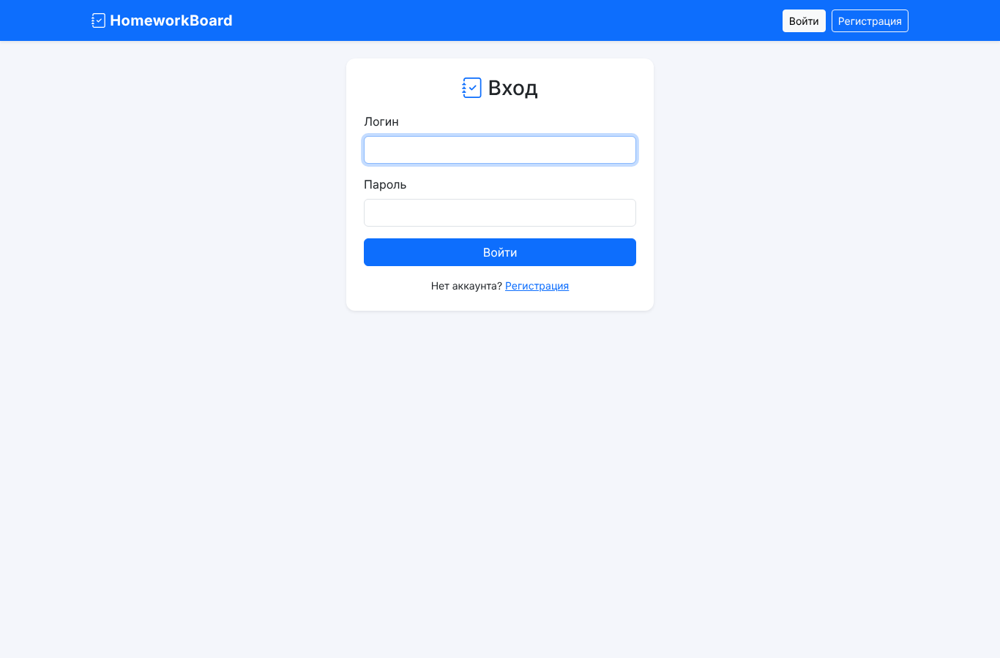
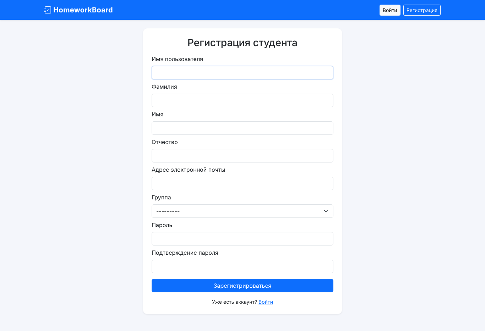

## Список домашних заданий

Карточки с предметом, сроком (цветной бейдж: сколько дней осталось или «срок истёк»), преподавателем
и статусом сдачи. **Поиск** работает по теме и тексту. **Фильтры:** предмет, срок (актуальные или
просроченные), статус студента (не сдано, на проверке, оценено). Пагинация сохраняет параметры
фильтрации благодаря тегу ``.

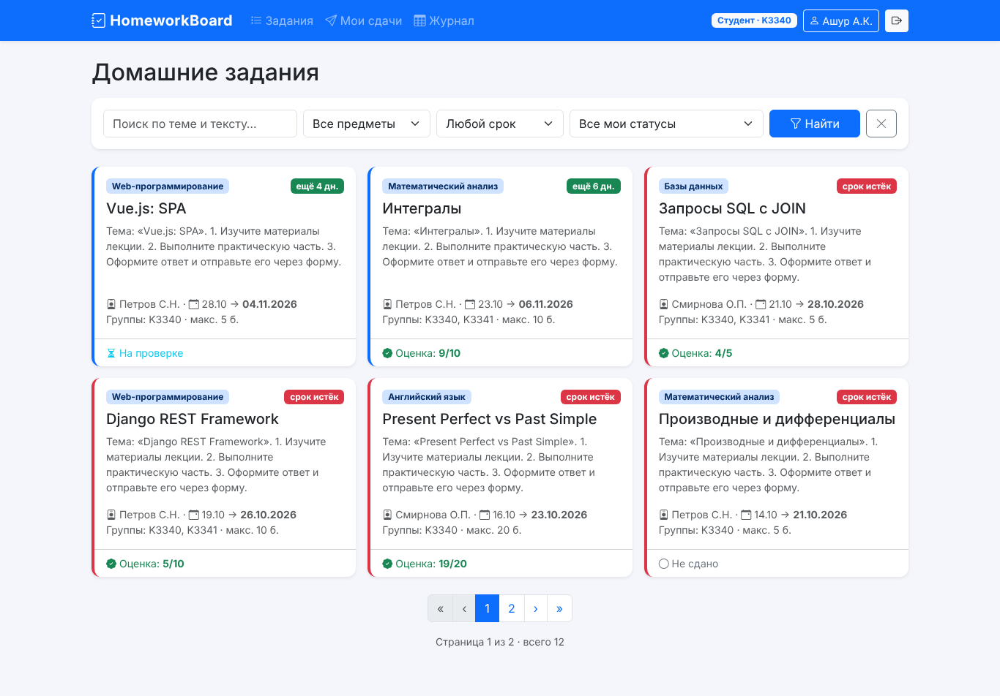

Преподаватель видит задания всех групп, количество сдач и сколько работ ждут проверки. Ему доступны
дополнительные фильтры «группа» и «только мои задания» и кнопка «Выдать задание».

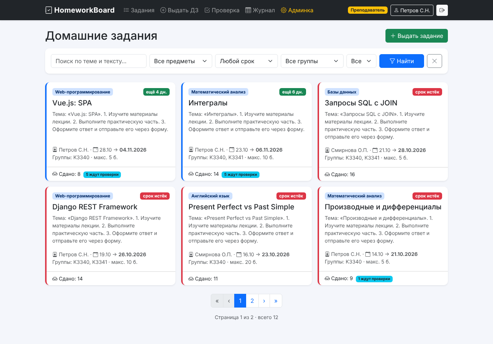

## Задание и сдача работы

Студент видит текст задания, период выполнения, дедлайн и штрафы. Справа находится форма сдачи.
До проверки ответ можно изменить или отменить. После проверки отображаются оценка и комментарий.

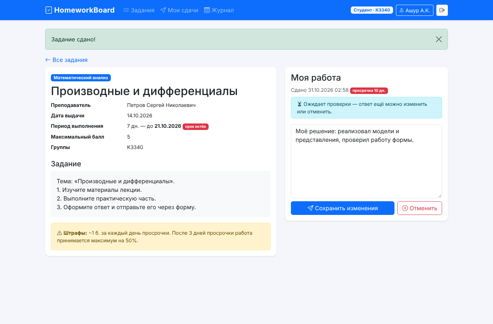
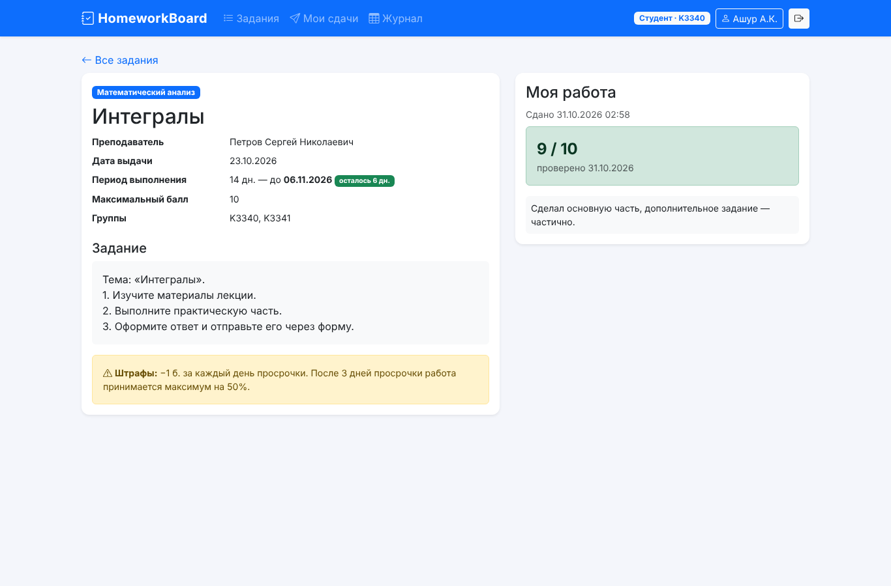

## Мои сдачи

Таблица своих работ с фильтром по предмету и статусу, с просрочкой и оценками.

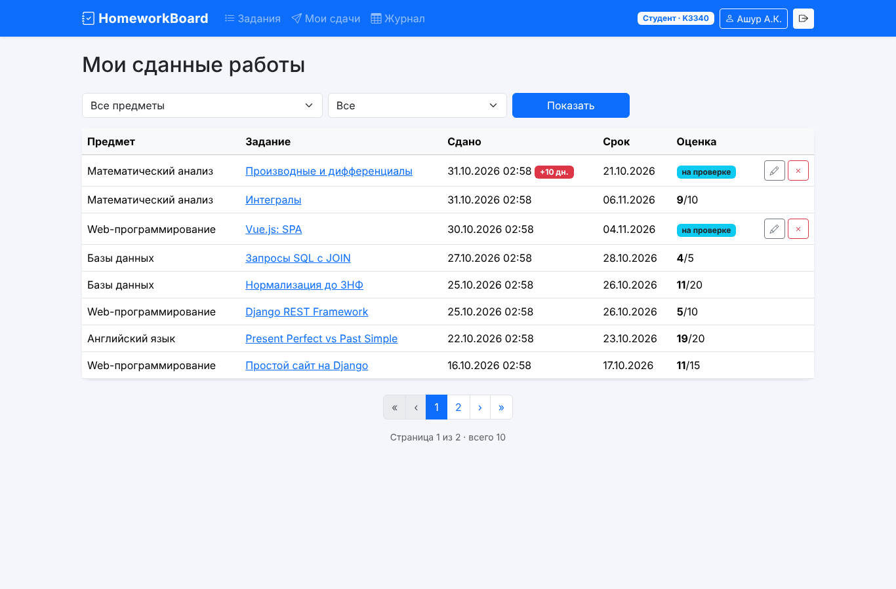

## Журнал оценок

Таблица «студенты × задания» для группы. Цвет ячейки зависит от процента от максимального балла.
Есть итоговая сумма и прогресс-бар. Фильтры: предмет, поиск по фамилии (преподаватель также выбирает
группу). Строка текущего студента подсвечивается.

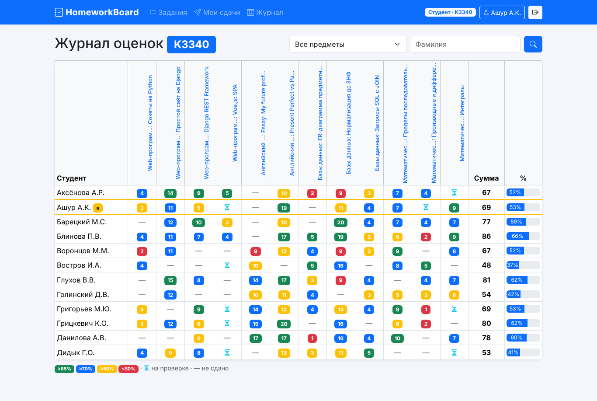
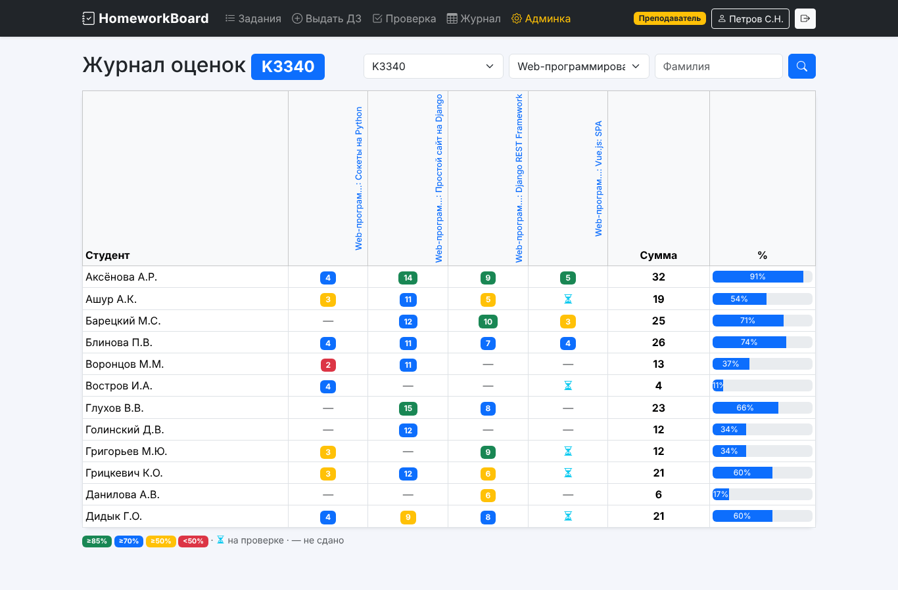

## Интерфейсы преподавателя

**Выдача задания** — форма `ModelForm` с выбором групп, периода, максимального балла и штрафов:

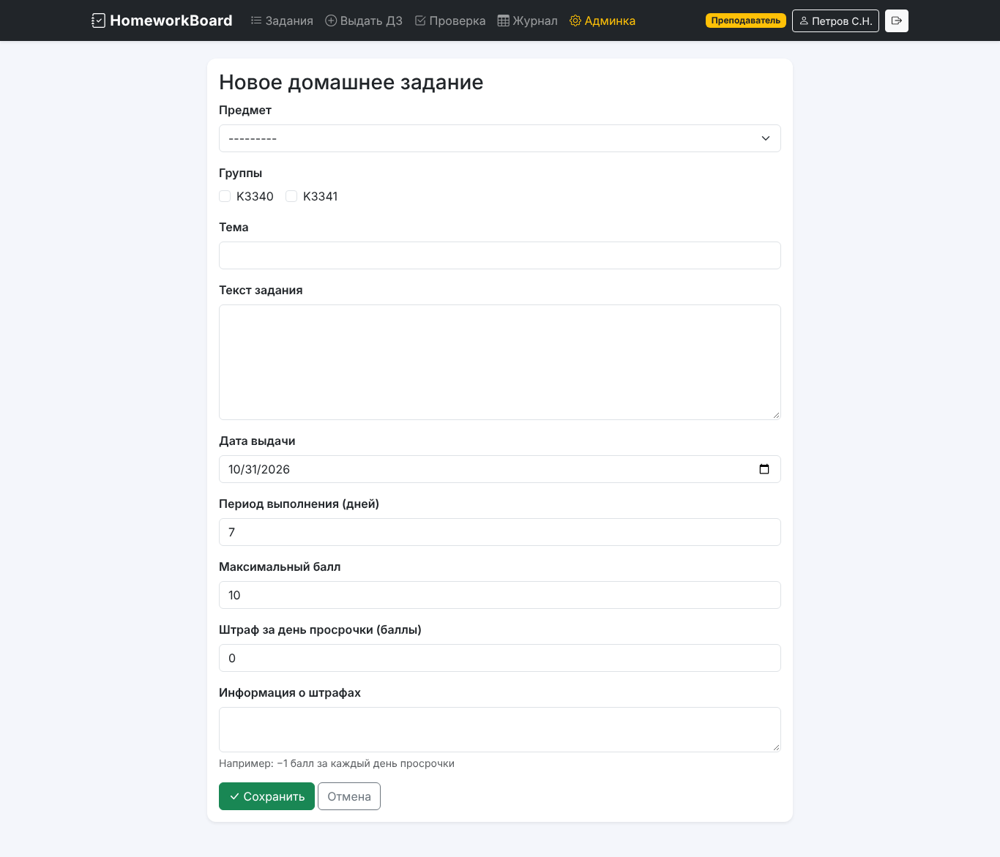

**Очередь проверки** — вкладки «ждут проверки», «проверенные», «все», фильтры по группе, предмету и
фамилии. Для каждой работы показаны просрочка и рекомендуемая оценка с учётом штрафа:

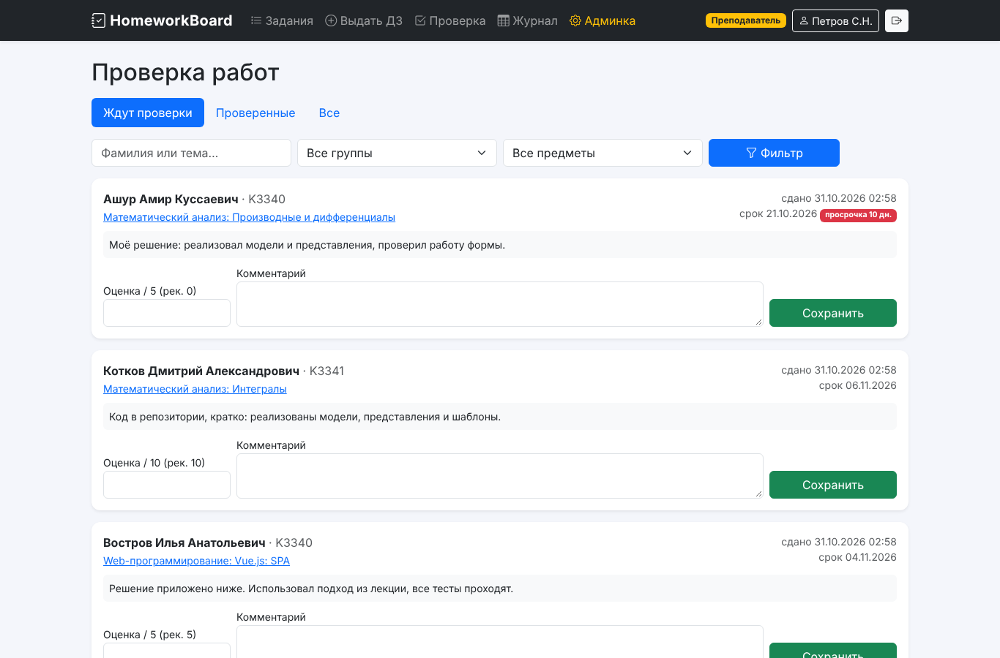

На странице задания преподаватель видит все сданные работы с формой оценки и список тех, кто ещё не сдал:

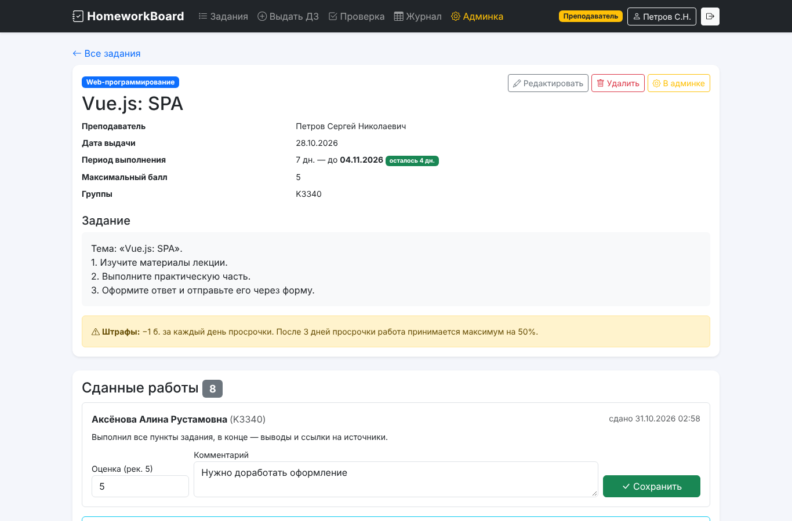

## Django Admin

Оценки выставляются прямо в списке (`list_editable = ('grade',)`), с фильтрами по предмету, группе
и наличию оценки. Рядом выводятся дни просрочки и рекомендуемая оценка.

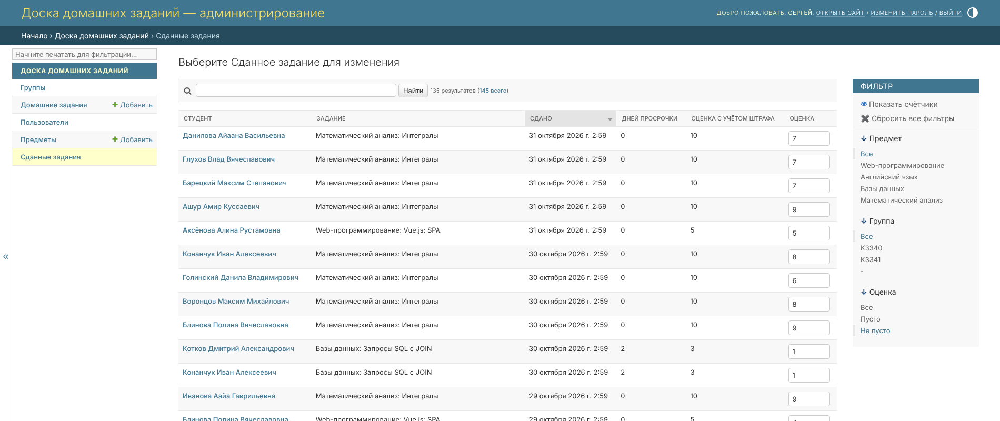
