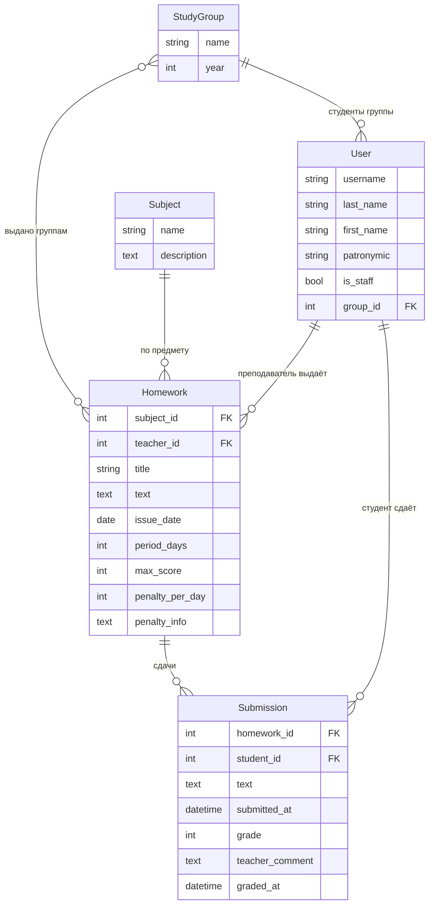

# Вариант 2. Доска домашних заданий

## Задание

Хранится информация о **предмете, преподавателе, дате выдачи, периоде выполнения, тексте задания
и штрафах**. Нужно реализовать:

- регистрацию новых пользователей;
- просмотр домашних заданий по всем предметам (сроки выполнения, описания);
- сдачу домашних заданий в текстовом виде;
- выставление оценок преподавателем (администратором) через Django Admin;
- таблицу оценок всех студентов группы в клиентской части.

## Модель данных



| Модель | Назначение | Ключевые решения |
|---|---|---|
| `User(AbstractUser)` | студент или преподаватель | роль определяется флагом `is_staff`; у студента есть группа |
| `StudyGroup` | учебная группа (класс) | одно ДЗ можно выдать нескольким группам (M2M) |
| `Subject` | предмет | |
| `Homework` | домашнее задание | дедлайн не хранится, а вычисляется: `issue_date + period_days` |
| `Submission` | сдача и оценка | одна сдача на студента и задание (`UniqueConstraint`); `graded_at` ставится автоматически |

Штраф хранится двумя полями: текстовым описанием (`penalty_info`) и числом баллов за день просрочки
(`penalty_per_day`). По ним считается рекомендуемая оценка, которую видит преподаватель:

```python
@property
def days_late(self):
    return max(0, (timezone.localdate(self.submitted_at) - self.homework.deadline).days)

@property
def suggested_grade(self):
    return max(0, self.homework.max_score - self.days_late * self.homework.penalty_per_day)
```

Оценка проверяется на диапазон `0..max_score` и в форме, и в `Model.clean()`, поэтому в админке
тоже нельзя поставить балл выше максимума.

## Роли

| Возможность | Гость | Студент | Преподаватель (`is_staff`) |
|---|:-:|:-:|:-:|
| Регистрация / вход | ✔ | | |
| Список ДЗ своей группы, поиск, фильтры | | ✔ | ✔ (все группы) |
| Сдать / изменить / отменить свою работу (до проверки) | | ✔ | |
| Журнал оценок | | своя группа | любая группа |
| Выдать, изменить, удалить ДЗ | | | ✔ |
| Очередь проверки, выставление оценок на сайте | | | ✔ |
| Django Admin | | | ✔ |

Чтобы преподаватель (не суперпользователь) мог выставлять оценки в Django Admin, миграция
`0002_teachers_group` создаёт группу **«Преподаватели»** с правами на задания, сдачи и предметы.
Сигнал `post_save` автоматически добавляет в неё каждого пользователя с `is_staff` и убирает, если флаг снят.

Студент выбирает группу при регистрации, а сменить её в профиле не может (это делает только администратор).
Иначе студент мог бы открыть журнал чужой группы.

Права проверяются на сервере (`LoginRequiredMixin`, `UserPassesTestMixin`, `user_passes_test`), а в
шаблонах через `` показываются разные меню, кнопки и блоки.
