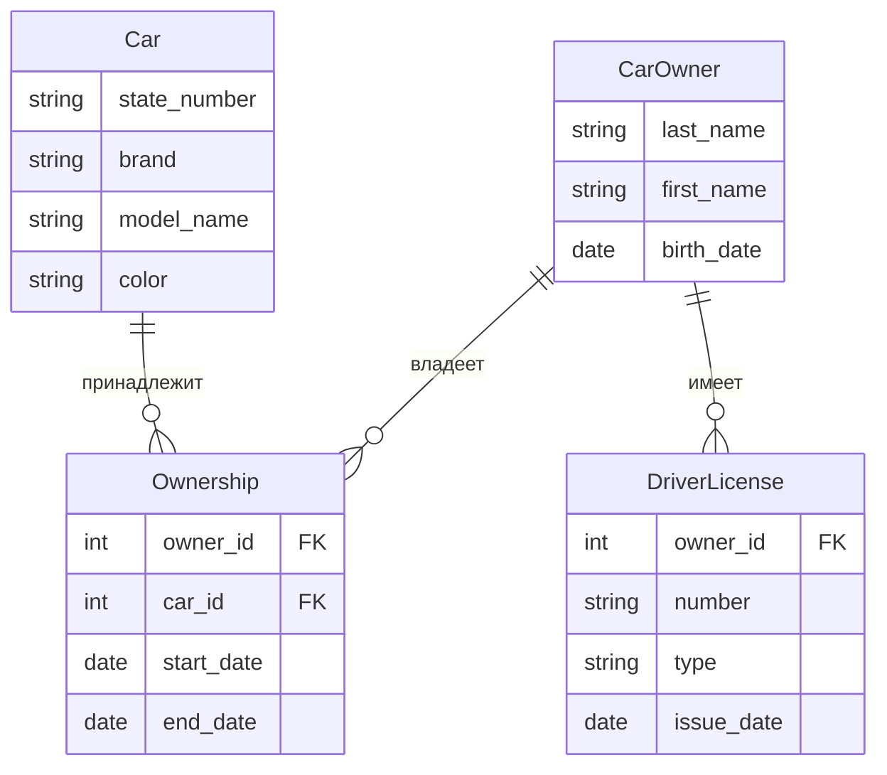
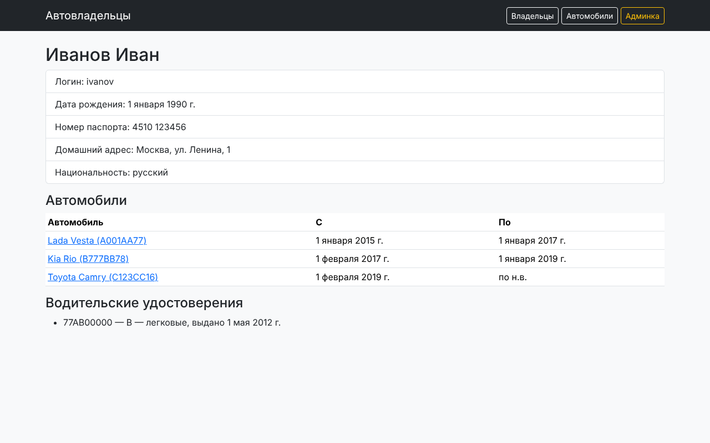

# Практическая работа 2.1. Установка Django и первое приложение

## Задание 1. Установка

```bash
python -m venv venv
venv\Scripts\activate          # Linux/macOS: source venv/bin/activate
pip install django
django-admin startproject django_project_ashur
cd django_project_ashur
python manage.py startapp project_first_app
```

Приложение добавлено в `INSTALLED_APPS` в `settings.py`.

## Задание 2. Модель данных об автовладельцах

По схеме из методички описаны четыре сущности: **Автовладелец**, **Автомобиль**,
**Владение** (ассоциативная сущность с датами) и **Водительское удостоверение**.



```python
class Car(models.Model):
    state_number = models.CharField('Гос. номер', max_length=15)
    brand = models.CharField('Марка', max_length=20)
    model_name = models.CharField('Модель', max_length=20)
    color = models.CharField('Цвет', max_length=30, null=True, blank=True)
    owners = models.ManyToManyField(settings.AUTH_USER_MODEL, through='Ownership')


class Ownership(models.Model):
    owner = models.ForeignKey(settings.AUTH_USER_MODEL, on_delete=models.CASCADE)
    car = models.ForeignKey(Car, on_delete=models.CASCADE)
    start_date = models.DateField('Дата начала')
    end_date = models.DateField('Дата окончания', null=True, blank=True)


class DriverLicense(models.Model):
    TYPES = (('A', 'A — мотоциклы'), ('B', 'B — легковые'), ('C', 'C — грузовые'), ...)
    owner = models.ForeignKey(settings.AUTH_USER_MODEL, on_delete=models.CASCADE)
    number = models.CharField('Номер удостоверения', max_length=10)
    type = models.CharField('Тип', max_length=10, choices=TYPES)
    issue_date = models.DateField('Дата выдачи')
```

!!! note "Модель владельца"
    В итоговой версии `CarOwner` наследуется от `AbstractUser` (практика 2.3). Это сделано сразу,
    потому что `AUTH_USER_MODEL` нужно задать **до первой миграции**.

Миграции:

```bash
python manage.py makemigrations
python manage.py migrate
```

## Задание 3. Админ-панель

Все модели зарегистрированы в `admin.py`, создан суперпользователь (`python manage.py createsuperuser`).
Добавлены владельцы и 4 автомобиля. У каждого из двух первых владельцев минимум три автомобиля, а периоды
владения не пересекаются, потому что автомобили переходили от одного владельца к другому
(скрипт `seed_practice.py`).

## Задания 4–5. Представление и маршрут

```python
# views.py
def owner_detail(request, owner_id):
    owner = get_object_or_404(CarOwner, pk=owner_id)
    return render(request, 'owner.html', {'owner': owner})

# project_first_app/urls.py
urlpatterns = [path('owner/<int:owner_id>/', views.owner_detail, name='owner_detail'), ...]

# django_project_ashur/urls.py
urlpatterns = [path('admin/', admin.site.urls), path('', include('project_first_app.urls'))]
```

Результат по адресу `127.0.0.1:8000/owner/2/`:


