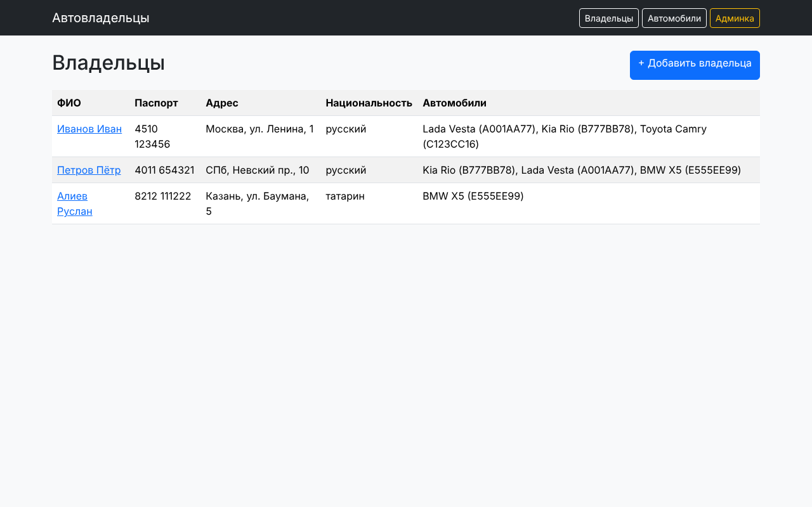
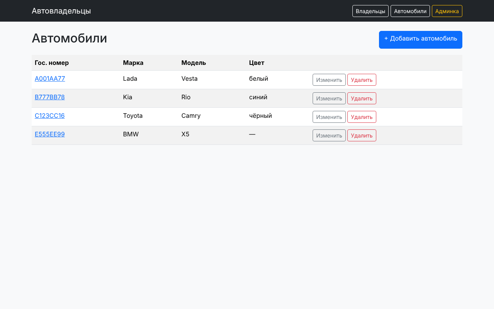

# Практическая работа 2.2. Связь M2M, представления и формы

## Задание 1. Связь «многие ко многим» через ассоциативную сущность

Автомобиль связан с владельцем через `Ownership` (`through='Ownership'`). Записи создаются явно,
потому что у связи есть свои атрибуты (`start_date`, `end_date`):

```python
Ownership.objects.create(owner=owner, car=car, start_date=date(2019, 2, 1))
```

## Задание 2. Вывод данных

**FBV — список всех владельцев** (`/owners/`):

```python
def owner_list(request):
    owners = CarOwner.objects.filter(is_superuser=False).prefetch_related('ownerships__car')
    return render(request, 'owner_list.html', {'owners': owners})
```



**CBV — автомобили:** `CarListView` (`/cars/`), `CarDetailView` (`/cars/<pk>/`), `CarUpdateView` (`/cars/<pk>/update/`).

```python
class CarListView(ListView):
    model = Car
    template_name = 'car_list.html'
    context_object_name = 'cars'

class CarDetailView(DetailView):
    model = Car
    template_name = 'car_detail.html'
```



## Задание 3. Формы

**FBV — форма владельца** (`/owners/create/`): после успешного POST выполняется `redirect`,
чтобы при обновлении страницы не появлялись дубликаты.

```python
def owner_create(request):
    if request.method == 'POST':
        form = CarOwnerForm(request.POST)
        if form.is_valid():
            form.save()
            return redirect('owner_list')
    else:
        form = CarOwnerForm()
    return render(request, 'owner_form.html', {'form': form})
```

**CBV — создание, изменение, удаление автомобиля:**

```python
class CarCreateView(CreateView):
    model = Car
    form_class = CarForm
    template_name = 'car_form.html'
    success_url = reverse_lazy('car_list')

class CarDeleteView(DeleteView):
    model = Car
    template_name = 'car_confirm_delete.html'
    success_url = reverse_lazy('car_list')
```

Шаблон удаления содержит POST-форму с `` и кнопкой подтверждения.
