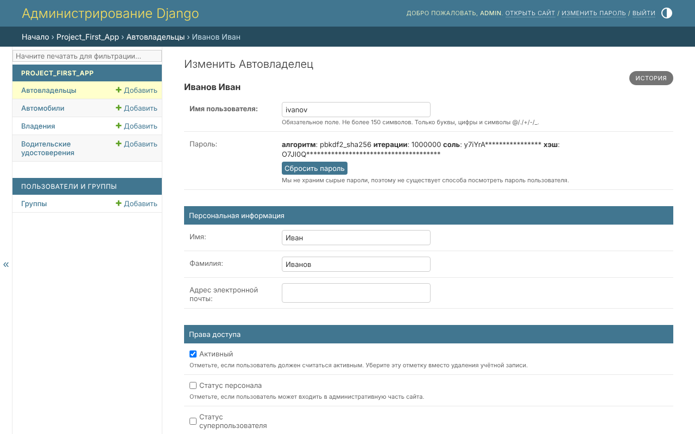
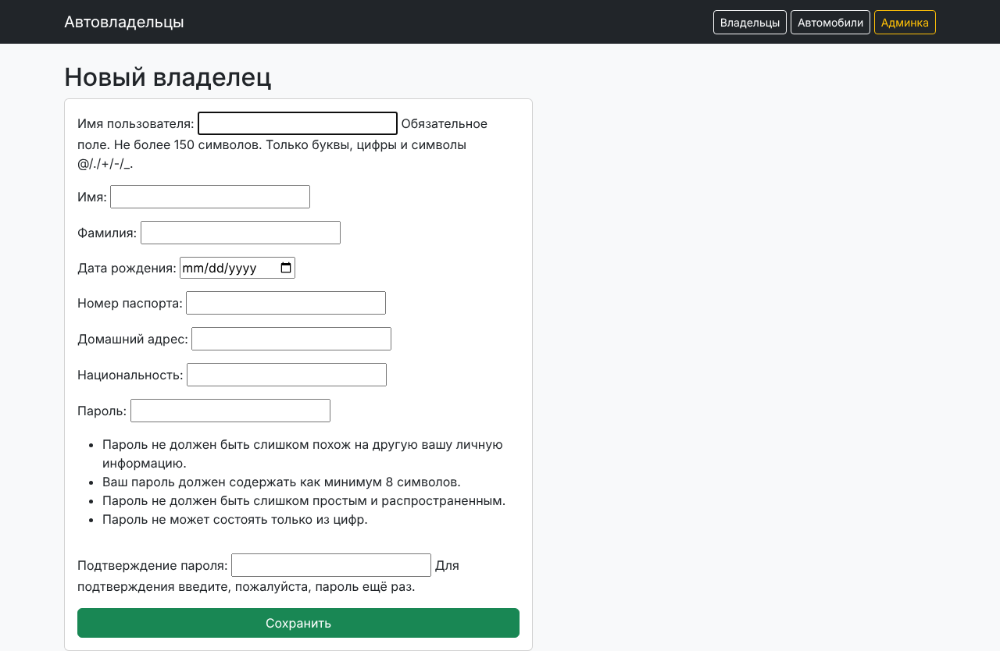

# Практическая работа 2.3. Расширение модели пользователя

Выбран способ **`AbstractUser`**: стандартная аутентификация подходит, но нужны дополнительные поля
прямо в таблице пользователей. «Владелец автомобиля» стал пользователем:

```python
class CarOwner(AbstractUser):
    birth_date = models.DateField('Дата рождения', null=True, blank=True)
    passport_number = models.CharField('Номер паспорта', max_length=20, blank=True)
    home_address = models.CharField('Домашний адрес', max_length=255, blank=True)
    nationality = models.CharField('Национальность', max_length=50, blank=True)
```

```python
# settings.py
AUTH_USER_MODEL = 'project_first_app.CarOwner'
```

Во всех внешних ключах используется `settings.AUTH_USER_MODEL`, а не прямой импорт класса.

## Новые поля в Django Admin

```python
@admin.register(CarOwner)
class CarOwnerAdmin(UserAdmin):
    fieldsets = UserAdmin.fieldsets + (
        ('Данные автовладельца', {'fields': ('birth_date', 'passport_number',
                                             'home_address', 'nationality')}),
    )
    add_fieldsets = UserAdmin.add_fieldsets + (...)
    inlines = [OwnershipInline, LicenseInline]
```



## Вывод информации о пользователях

Страница владельца и список владельцев (из практик 2.1 и 2.2) показывают паспорт, адрес и национальность.

## Интерфейс создания пользователя

Форма на основе `UserCreationForm` с новыми атрибутами, пароль хэшируется стандартными средствами Django:

```python
class CarOwnerForm(UserCreationForm):
    class Meta:
        model = CarOwner
        fields = ('username', 'first_name', 'last_name', 'birth_date',
                  'passport_number', 'home_address', 'nationality')
```


